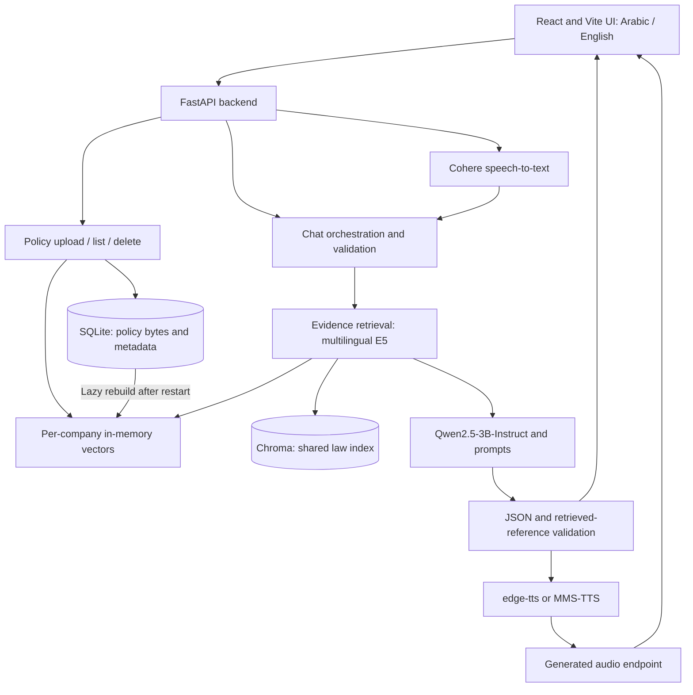

# مرجعك القانوني | Marjaak AlQanoni

A bilingual AI assistant for private-sector employees and HR teams in Saudi Arabia. It retrieves passages from the supplied Saudi Labor Law PDF and the selected company's policies, then generates an Arabic or English answer with source quotations and practical next steps.

**Team:** رواد الذكاء الاصطناعي · **Program:** Tuwaiq Bootcamp Capstone · **Status:** Development prototype

> مرجعك القانوني يساعد الموظفين وفرق الموارد البشرية على فهم نظام العمل السعودي ومقارنته بسياسات الشركة، من خلال أسئلة نصية أو صوتية وإجابات مدعومة بمراجع. هذا المشروع نموذج أولي، ولا يغني عن مراجعة مختص قانوني.

## Project links

| Resource          | Location                                                                              |
| ----------------- | ------------------------------------------------------------------------------------- |
| GitHub repository | [MohammadAlfagih/MarjaakAlQanoni](https://github.com/MohammadAlfagih/MarjaakAlQanoni) |
| Local application | http://localhost:5173 after starting the frontend                                     |
| API documentation | http://127.0.0.1:8000/docs after starting the backend                                 |

## Contents

- [Problem, users, and features](#problem-users-and-features)
- [Project structure](#project-structure)
- [Architecture and request flow](#architecture-and-request-flow)
- [Models and adaptation](#models-and-adaptation)
- [Data, preprocessing, and licenses](#data-preprocessing-and-licenses)
- [Installation and startup](#installation-and-startup)
- [Using the application](#using-the-application)
- [API reference](#api-reference)
- [Configuration](#configuration)
- [Evaluation and results](#evaluation-and-results)
- [Limitations](#limitations)
- [Troubleshooting](#troubleshooting)
- [Team and responsibilities](#team-and-responsibilities)

## Problem, users, and features

Employees need understandable answers when dealing with probation, leave, wages, working hours, resignation, termination, and end-of-service benefits. HR teams also need to compare internal policies with the legal text. Finding and interpreting the relevant passages across a long law document and company manuals takes time.

Marjaak AlQanoni combines retrieval-augmented generation (RAG) with a bilingual interface so users can inspect the evidence behind an answer.

| Feature                    | Current implementation                                                                               |
| -------------------------- | ---------------------------------------------------------------------------------------------------- |
| Arabic and English         | Arabic RTL interface by default, English LTR toggle, requested-language answers                      |
| Evidence-backed text chat  | Qwen generates answers from retrieved law and optional company-policy excerpts                       |
| Source display             | Original retrieved quotations, article labels, and PDF page or policy location references            |
| Company-policy management  | Upload, list, and delete PDF, DOCX, and UTF-8 TXT policies from the HR screen                        |
| Company-specific retrieval | Searches only the selected company's policy vector store alongside the shared law index              |
| Conflict reporting         | A conflict response must cite both retrieved law and policy evidence                                 |
| Uncertainty and follow-ups | Structured `answered`, `clarify`, `unknown`, and `out_of_scope` statuses                             |
| Voice input and playback   | Speech transcription, the same chat pipeline, and synthesized answers with browser playback fallback |
| Backend-free UI demo       | Mock mode for exploring the interface without downloading models                                     |

The login screen selects a demo role and company. It does not authenticate users or enforce server-side HR permissions.

## Project structure

```text
MarjaakAlQanoni/
├── README.md                       # Project overview and setup
├── LICENSE                         # MIT license for project code
├── app.py                          # Root API launcher
├── apps/
│   ├── FrontEnd/
│   │   ├── .env.example            # Mock/real API configuration
│   │   ├── package.json            # React/Vite dependencies and commands
│   │   ├── package-lock.json       # Locked frontend dependencies
│   │   └── src/
│   │       ├── api/                # Real API client and mock responses
│   │       ├── pages/              # Landing, Login, Chat, Policies
│   │       ├── components/         # Header, icons, answer cards
│   │       ├── hooks/              # Recording and audio playback
│   │       ├── context/            # Language and demo session
│   │       └── i18n/               # Arabic/English interface strings
│   └── api/
│       ├── README.md               # Detailed local and Colab instructions
│       ├── requirements.txt        # Backend dependency list
│       ├── companies.json          # Demo company IDs and names
│       ├── app/app.py              # FastAPI assembly, CORS, health
│       ├── services/
│       │   ├── RAG/
│       │   │   ├── rag.py          # Extraction, embeddings, index, retrieval
│       │   │   └── labor-law.pdf   # Runtime law corpus
│       │   ├── llm/
│       │   │   ├── client.py       # Qwen loading and generation
│       │   │   └── chat.py         # Prompts, orchestration, validation
│       │   └── policies/           # Policy upload, storage, retrieval
│       └── voice/                  # STT, TTS, audio conversion, routes
├── Data/labor-law.pdf               # Matching copy of the law PDF
├── scripts/package_api.py           # Backend-only ZIP for Colab
└── tests/                          # unittest integration and retrieval checks
```

Generated model caches, `apps/api/services/RAG/chroma_e5_db/`, and `apps/api/.data/` are gitignored. The packaging script creates `tmp/marjaak-api.zip`.

## Architecture and request flow



1. The frontend sends a question, language, demo role, optional company ID, and conversation history.
2. The backend retrieves up to five law chunks and three policy chunks. Law retrieval always runs. Selecting a company adds its policies.
3. Retrieved sources receive `L1`, `L2`, etc. for law and `P1`, `P2`, etc. for policies. The prompt separates the two evidence groups.
4. Qwen receives the system prompt, question, bounded history, and evidence through its chat template. It returns JSON containing an answer and evidence labels.
5. The server validates the JSON and referenced labels, rejects unsupported conflict structures, and builds displayed quotations from the original retrieved text. It can attempt one repair of invalid output or one review when an evidence group was omitted.
6. The UI displays the answer, sources, conflict flag, and next steps. Voice requests first transcribe audio and can return spoken output.

For clarification replies, recent user context helps retrieval interpret the follow-up. A new topic retrieves using the new question. Generation receives at most eight recent messages, with user messages limited to 2,000 characters and assistant excerpts to 400 characters.

**Storage:** The law index persists in Chroma. `/policies` saves uploaded file bytes and metadata in SQLite, while policy vectors remain in memory and rebuild lazily after restart. `/rag/search` supports a separate request-local PDF. SQLite is policy storage, not an implemented chat-monitoring database.

## Models and adaptation

| Component           | Model or technology                                              | Purpose                                                          |
| ------------------- | ---------------------------------------------------------------- | ---------------------------------------------------------------- |
| Answer generation   | `Qwen/Qwen2.5-3B-Instruct`                                       | Bilingual answers and structured output from retrieved evidence  |
| Embeddings          | `intfloat/multilingual-e5-small`                                 | Shared law and company-policy retrieval                          |
| Law vector database | Chroma                                                           | Persistent, fingerprinted law index                              |
| Policy vectors      | LangChain `InMemoryVectorStore`                                  | Separate search store for each company                           |
| Speech-to-text      | `CohereLabs/cohere-transcribe-arabic-07-2026`                    | Arabic/English transcription with an explicit language selection |
| Text-to-speech      | `edge-tts`, then `facebook/mms-tts-ara` / `facebook/mms-tts-eng` | Spoken answers in Arabic or English                              |
| Application         | FastAPI, React 19, Vite 6                                        | API and browser interface                                        |

Qwen 3B was selected to balance Arabic answer quality and compute requirements.

The implemented adaptation is **a pretrained instruction model + prompt engineering + RAG**. The prompt covers case questions, policy review, requested language, uncertainty, citation labels, and JSON format. Fine-tuning, LoRA/QLoRA, DPO/RLHF, and quantization are not implemented. `ml/train_lora.py` is empty and is not a training command.

Generation uses greedy decoding (`do_sample=False`), a 12,000-token input limit, and up to 768 new tokens. Qwen uses float16 with CUDA and float32 on CPU. These inference settings do not represent training or measured quality guarantees.

## Data, preprocessing, and licenses

| Data                       | Source and contents                                                                                                                                                                                                  | Use and licensing status                                                                                                                |
| -------------------------- | -------------------------------------------------------------------------------------------------------------------------------------------------------------------------------------------------------------------- | --------------------------------------------------------------------------------------------------------------------------------------- |
| Saudi Labor Law PDF        | Official [MHRSD Saudi Labor Law PDF](https://www.hrsd.gov.sa/sites/default/files/2025-11/labor-law.pdf). Local copies are in [Data/](Data/labor-law.pdf) and the [RAG service](apps/api/services/RAG/labor-law.pdf). | Arabic, 68-page retrieval corpus. Both local copies are identical. A separate redistribution license is not recorded in the repository. |
| Company policies           | User-provided PDF, DOCX, or UTF-8 TXT documents                                                                                                                                                                      | Optional company evidence. Uploaders must have permission to use their documents. No company-policy corpus or license is supplied.      |
| Demo companies and answers | [companies.json](apps/api/companies.json) and [mock.js](apps/FrontEnd/src/api/mock.js)                                                                                                                               | UI examples, not a labeled legal benchmark. Mock article text is placeholder content.                                                   |
| Automated test fixtures    | [tests/](tests/)                                                                                                                                                                                                     | Synthetic policies, test vectors, mocked model responses, and selected retrieval scenarios.                                             |

The RAG documentation reports 245 numbered articles plus four `مكرر` provisions, producing 325 chunks with the current settings. Arabic and English questions both retrieve from the Arabic corpus.

Preprocessing and retrieval:

- Extract text using PyMuPDF and layout rules tailored to the supplied PDF. Exclude chapter headings and small amendment footnotes from article bodies.
- Preserve article numbers, repeated-article markers, and one-based PDF page references. PDF page references can differ from printed page numbers.
- Split within articles using a 450-character chunk size and 70-character overlap. Long articles can span multiple chunks.
- Embed with E5's `query:` and `passage:` prefixes, masked mean pooling, and normalized vectors. The embedding dimension is 384.
- Filter explicit Arabic or English article-number requests. Expand recognized English law topics with Arabic glossary terms without inventing article numbers.
- Check the index fingerprint against the PDF, model, extraction version, and chunk settings. Reject missing, stale, or incomplete indexes.
- Preserve PDF pages, DOCX paragraph/table positions, or TXT line numbers for policy citations. Deduplicate identical uploaded bytes within one company.

The project code uses the [MIT license](LICENSE). Model weights and source documents retain their own terms:

| Asset                | License / terms reference                                                                                                                            |
| -------------------- | ---------------------------------------------------------------------------------------------------------------------------------------------------- |
| Qwen 3B              | [Qwen Research License, as identified in the model card](https://huggingface.co/Qwen/Qwen2.5-3B-Instruct)                                            |
| E5 embeddings        | [MIT license, as identified in the model card](https://huggingface.co/intfloat/multilingual-e5-small)                                                |
| Cohere transcription | [Apache 2.0 model card](https://huggingface.co/CohereLabs/cohere-transcribe-arabic-07-2026), with gated access handled during setup                  |
| MMS-TTS              | [Arabic model card: CC-BY-NC 4.0](https://huggingface.co/facebook/mms-tts-ara) and [English model card](https://huggingface.co/facebook/mms-tts-eng) |
| edge-tts             | Uses an external Microsoft speech service. Service availability and applicable terms are separate from the repository's MIT license.                 |

## Installation and startup

### Prerequisites

- Python 3.12 for the backend setup below.
- Node.js 18+ and npm for the frontend, as documented in its README.
- Internet for dependency installation and first model downloads. `edge-tts` also needs an internet connection.
- A CUDA-enabled PyTorch installation and NVIDIA GPU for practical full-model inference. The backend supports CPU placement, but CPU generation needs more RAM and time. No measured minimum hardware specification is included.
- For voice input, a Hugging Face account/token with access to the gated Cohere model.

Commands below use PowerShell on Windows. Run them from the indicated directory.

### 1. Clone the repository

```powershell
git clone https://github.com/MohammadAlfagih/MarjaakAlQanoni.git
Set-Location MarjaakAlQanoni
```

If you already have the repository, start from its root.

### 2. Create a backend environment

```powershell
python -m venv .venv
.\.venv\Scripts\python.exe -m pip install -r apps/api/requirements.txt
```

The dependency list is [apps/api/requirements.txt](apps/api/requirements.txt), rather than a root `requirements.txt`. GPU workstations need a PyTorch build compatible with their CUDA setup. The detailed [backend guide](apps/api/README.md) includes a Colab installation path that preserves Colab's installed CUDA PyTorch.

### 3. Inspect and build the law index, then start the API

```powershell
.\.venv\Scripts\python.exe -m apps.api.services.RAG.rag --inspect
.\.venv\Scripts\python.exe app.py --build-index
```

The first index build downloads E5. Without `--preload`, Qwen loads on the first chat request that has evidence, and speech models load when needed. Leave this terminal running.

To load the answer and speech models before accepting requests, configure voice access first, then use:

```powershell
.\.venv\Scripts\python.exe app.py --build-index --preload
```

Open http://127.0.0.1:8000/docs and check http://127.0.0.1:8000/health. Health reports model loading state and the serving process ID, not answer accuracy. Use one worker so the models load once per process. The root launcher reserves the port before allocating models.

### 4. Configure voice access when needed

Accept the terms on the [Cohere model page](https://huggingface.co/CohereLabs/cohere-transcribe-arabic-07-2026) with the account whose token you use. Set `HF_TOKEN` privately in the API process environment before starting the server. Do not commit tokens. Colab users can supply the token through Colab Secrets as described in the [backend guide](apps/api/README.md).

If speech-model preloading fails, text chat remains available. `/health` reports `stt_error`, and `/voice` returns `503`.

### 5. Start the real frontend

Open a second terminal at the repository root:

```powershell
Set-Location apps/FrontEnd
npm ci
Copy-Item .env.example .env
```

Edit `apps/FrontEnd/.env`:

```dotenv
VITE_USE_MOCK=false
VITE_API_URL=http://localhost:8000
```

Then run:

```powershell
npm run dev
```

Open http://localhost:5173. Restart Vite after changing `.env`. If Vite uses another port, add that origin to the backend's `FRONTEND_ORIGINS` and restart the API.

### Frontend-only demo

Follow step 5 but keep `VITE_USE_MOCK=true` from `.env.example`. This mode works without the backend and demonstrates UI behavior using placeholder answers. It does not demonstrate live model accuracy or retrieval.

### Colab GPU backend

```powershell
python scripts/package_api.py
```

Upload `tmp/marjaak-api.zip` into a Colab GPU runtime. Follow the complete [Colab setup, readiness checks, and ngrok instructions](apps/api/README.md#colab-upload-python-files-then-run-apppy). The archive includes root `app.py` and the backend source/PDF, while excluding caches, policy storage, credentials, and frontend dependencies.

Set the local frontend's `VITE_API_URL` to the tunnel's HTTPS base URL and restart Vite. Do not append `/chat` or `/docs`. The tunnel expires with the runtime, and policy storage must be backed up separately if it needs to survive Colab shutdown.

### Frontend production build

From `apps/FrontEnd/`:

```powershell
npm run build
npm run preview
```

These commands build and preview the frontend.

## Using the application

1. Open the landing page and select Arabic or English.
2. Choose Employee or HR and, optionally, a demo company. Leaving the company unset gives law-only answers.
3. An HR session with a selected company can open Policies and upload a permitted PDF, DOCX, or TXT document.
4. Ask a text question or use the microphone. Example test prompts: `كم عدد أيام الإجازة السنوية؟` or `What are my annual leave rights?`.
5. Read the answer together with its source cards. Review any conflict flag and suggested next steps. Reply when the assistant requests clarification.
6. Use Listen for playback. Voice recording requires microphone permission and a localhost or HTTPS page.

Policy uploads are limited to 10,000,000 bytes. PDFs must contain extractable text and have at most 40 pages. DOCX expanded content is bounded at 30,000,000 bytes. Scanned PDFs require OCR, which is not implemented.

## API reference

| Method and route                 | Purpose                                                                             |
| -------------------------------- | ----------------------------------------------------------------------------------- |
| `GET /health`                    | Process ID, model ID, Qwen/STT loading state and STT startup error                  |
| `GET /companies`                 | Demo companies from `companies.json`                                                |
| `POST /chat`                     | Generate a structured answer from law and selected-company evidence                 |
| `POST /chat/evidence`            | Inspect the same retrieval path without loading Qwen                                |
| `POST /rag/search`               | Multipart retrieval with `question` and optional request-local `policy_file` PDF    |
| `GET /policies?company_id=c_101` | List a company's saved policy metadata                                              |
| `POST /policies`                 | Multipart `company_id` and `file`, returning a policy record with HTTP `201`        |
| `DELETE /policies/{policy_id}`   | Remove a policy record and its cached vectors, returning HTTP `204`                 |
| `POST /voice`                    | Multipart `audio`, `role`, optional `company_id`, `lang`, and JSON-string `history` |
| `POST /tts`                      | JSON `{text, lang}` to a generated audio URL                                        |
| `GET /audio/{id}.mp3` or `.wav`  | Retrieve generated spoken output                                                    |

Example `/chat` request, also accepted by `/chat/evidence`:

```json
{
  "question": "What are my annual leave rights?",
  "role": "employee",
  "company_id": "c_101",
  "lang": "en",
  "history": []
}
```

Use `company_id: null` or omit it for law-only retrieval. `role` is `employee` or `hr`, and `lang` is `ar` or `en`. Questions must be 1–2,000 characters after trimming. History accepts user/assistant messages and optional assistant statuses, not system messages.

Response shape below illustrates fields, not an evaluated legal answer:

```json
{
  "answer": "Generated explanation based on the retrieved evidence.",
  "articles": [
    {
      "ref": "[L1] Retrieved article title (PDF page reference)",
      "source": "law",
      "quote": "Original retrieved source passage."
    }
  ],
  "next_steps": ["Suggested practical step."],
  "conflict": false,
  "status": "answered",
  "lang": "en"
}
```

Voice adds `transcript` and `audio_url`. If synthesis fails, `audio_url` can be `null` and the frontend can use an available browser voice. Internal model output uses `evidence_refs`; public source quotations come from retrieved documents.

Common errors: `404` unknown company/policy, `422` invalid input or an oversized prompt, `502` invalid or unsupported model output, and `503` unavailable model/index/storage. See the interactive `/docs` page for schemas.

## Configuration

Set backend variables in the environment before starting the process. The backend does not automatically load a root `.env` file. Frontend `VITE_*` values belong in `apps/FrontEnd/.env` and are public browser configuration.

| Variable                        | Default / purpose                                                                      |
| ------------------------------- | -------------------------------------------------------------------------------------- |
| `VITE_USE_MOCK`                 | Example file sets `true`; set `false` for real API requests                            |
| `VITE_API_URL`                  | `http://localhost:8000`, or a temporary HTTPS tunnel base URL                          |
| `FRONTEND_ORIGINS`              | `http://localhost:5173,http://127.0.0.1:5173`; comma-separated allowed browser origins |
| `LLM_MODEL_NAME`                | `Qwen/Qwen2.5-3B-Instruct`                                                             |
| `LLM_DEVICE`                    | `auto`, `cpu`, or `cuda`; default `auto`                                               |
| `LLM_PRELOAD`                   | `1` preloads models; also set by the launcher with `--preload`                         |
| `POLICIES_DATA_DIR`             | `apps/api/.data/`; controls the policy SQLite location, not the audio directory        |
| `HF_TOKEN`                      | Private Hugging Face token for gated speech-model access                               |
| `STT_MODEL_NAME`                | `CohereLabs/cohere-transcribe-arabic-07-2026`                                          |
| `STT_DTYPE`                     | Optional `float32`, `float16`, or `bfloat16` override                                  |
| `TTS_ENGINE`                    | `auto` tries edge then MMS; alternatives `mms` and `edge`                              |
| `TTS_VOICE_AR` / `TTS_VOICE_EN` | edge voices default to `ar-SA-HamedNeural` / `en-US-AndrewNeural`                      |
| `RAG_LIVE_TESTS`                | Set `1` to enable real E5/index tests                                                  |
| `HF_HUB_OFFLINE`                | Set `1` for cached-model retrieval tests after downloads and index creation            |

Launcher options are `--host` (default `127.0.0.1`), `--port` (default `8000`), `--build-index`, and `--preload`.

## Evaluation and results

### Human evaluation

We tested the model on **20 questions** using human evaluation. Each question was scored out of 5 for citations and out of 5 for the generated answer. Each column below is the sum of its 20 scores, out of 100.

| Questions | Citation score (out of 100) | Generated-answer score (out of 100) |
| --------- | --------------------------- | ----------------------------------- |
| 20        | 88.5                   | 80.5                           |

### Automated tests

The test suite covers law extraction, citation metadata, chat validation, policy storage and company isolation, startup behavior, and voice handling.

After installing backend dependencies, from the repository root:

```powershell
.\.venv\Scripts\python.exe -m unittest discover -s tests -v
```

The regular suite uses mocked models/test vectors to avoid downloading Qwen. For actual E5 retrieval, first build the index and cache E5, then run:

```powershell
.\.venv\Scripts\python.exe -m apps.api.services.RAG.rag --build
$env:RAG_LIVE_TESTS = "1"
$env:HF_HUB_OFFLINE = "1"
.\.venv\Scripts\python.exe -m unittest discover -s tests -v
Remove-Item Env:RAG_LIVE_TESTS
Remove-Item Env:HF_HUB_OFFLINE
```

## Limitations

- **Legal reliability:** Reference validation confirms that cited labels were retrieved and quotations match source text. It does not prove that each generated claim is supported or legally correct. Review evidence and consult qualified professionals for decisions.
- **Corpus coverage:** The supplied Arabic PDF is the runtime source. Extraction excludes some footnotes and targets this document's layout. The application does not verify that the corpus reflects the latest amendments.
- **Policy retention:** `/policies` persists original bytes in SQLite until deletion. Its deletion route removes the record and cached vectors, without guaranteeing secure erasure from SQLite pages, backups, or filesystem media. `/rag/search` remains request-local.
- **Authorization:** Company stores are separated by selected ID, but the API does not authenticate the caller's company or role. The HR-only policy page is a browser navigation guard. This prototype is unsuitable for confidential company deployment without authentication and access controls.
- **Voice quality:** Speech quality and dialect performance have not been benchmarked.
- **External speech service:** `edge-tts` sends answer text to an external speech service. `TTS_ENGINE=mms` selects in-process synthesis. Synthesized audio is saved under `apps/api/.data/audio`; files older than one hour are cleaned when synthesis runs, rather than by a scheduled deletion job.
- **Prompt versus enforcement:** The prompt requests relevant law citations, language compliance, and practical steps. Structural validation does not enforce every semantic instruction or automatically prove compliance.
- **Monitoring:** Dedicated monitoring and alerting are not implemented.

## Troubleshooting

| Symptom                                  | Action                                                                                                                                                 |
| ---------------------------------------- | ------------------------------------------------------------------------------------------------------------------------------------------------------ |
| UI shows demo answers                    | Set `VITE_USE_MOCK=false`, confirm `VITE_API_URL`, and restart Vite.                                                                                   |
| Browser cannot reach API                 | Check `/health`, the backend base URL, and `FRONTEND_ORIGINS`.                                                                                         |
| Missing or stale index (`503`)           | Build the index. For a stale/incomplete index, stop the API, back up or rename only `apps/api/services/RAG/chroma_e5_db/`, then rebuild. Keep the PDF. |
| Port already in use                      | Stop the previous backend or select `--port`; update `VITE_API_URL` if the port changes.                                                               |
| Voice unavailable (`503`)                | Check `/health` for `stt_error`, model access terms, `HF_TOKEN`, dependencies, and available GPU memory.                                               |
| Microphone unavailable                   | Use localhost or HTTPS and permit microphone access in the browser.                                                                                    |
| edge-tts fails                           | `auto` can fall back to MMS; use `TTS_ENGINE=mms` where the external speech service is unavailable.                                                    |
| Policies missing after restart           | Check company ID, `GET /policies`, and `POLICIES_DATA_DIR`. Colab storage disappears with the runtime unless backed up.                                |
| Policy retrieved but not shown in answer | Compare `/chat/evidence` with `/chat` for the same request. Retrieval and the model's citation selection are separate steps.                           |
| Scanned policy rejected (`422`)          | Supply an extractable-text PDF, DOCX, or UTF-8 TXT file within the limits.                                                                             |
| Invalid generated answer (`502`)         | Inspect the model response/evidence flow; do not treat rejected output as a verified answer.                                                           |
| Slow startup or generation               | First downloads and cold loading take time. Check CUDA availability, memory, and single-worker operation.                                              |

Detailed guides: [Backend and Colab](apps/api/README.md), [RAG](apps/api/services/RAG/README.md), [Voice](apps/api/voice/README.md), and [Frontend](apps/FrontEnd/README.md).

## Team and responsibilities

Team **رواد الذكاء الاصطناعي**:

| Member                              | Role                                | Main responsibilities                                                           |
| ----------------------------------- | ----------------------------------- | ------------------------------------------------------------------------------- |
| عبدالعزيز أبانمي — Abdulaziz Abanmi | Project Lead and Prompt Engineering | Coordinate tasks, design prompts, review outputs, and prepare the documentation |
| محمد العمران — Mohammed Alomran     | RAG and Model Lead                  | Build law/policy retrieval, manage retrieval behavior, and select the LLM       |
| جميل محجوب — Jameel Mahjub          | UI, Language, and Voice Lead        | Design the interface, support Arabic/English, and integrate speech input/output |
| محمد الفقيه — Mohammad Alfagih      | Evaluation Lead                     | Prepare test scenarios and evaluate answer and citation quality.                |
